<!-- [ADD: portfolio URL] Uncomment once your portfolio site is published:

-->

<!-- [ADD: contribution snake] Optional: add a GitHub Action that generates a contribution-graph animation, then embed it here. -->

