<a href="https://github.com/krishna6116">
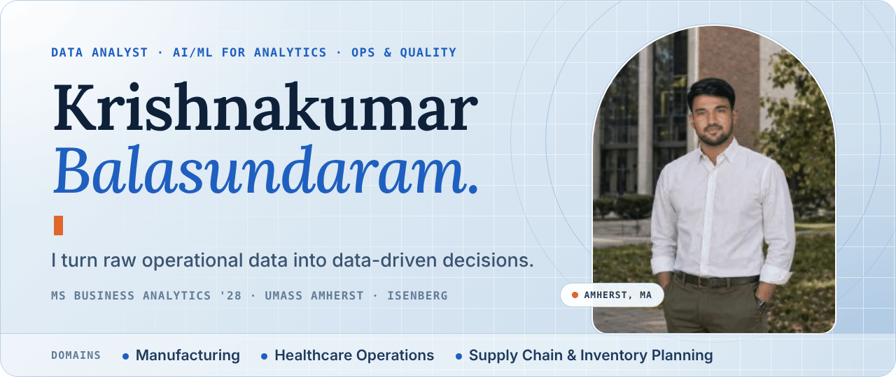
</a>

<!-- [ADD: portfolio URL] Uncomment once your portfolio site is published:

-->

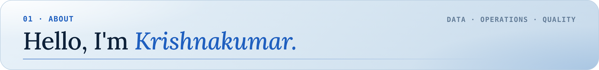

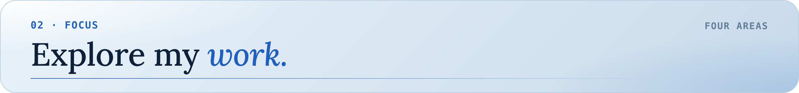
<a href="https://github.com/krishna6116?tab=repositories">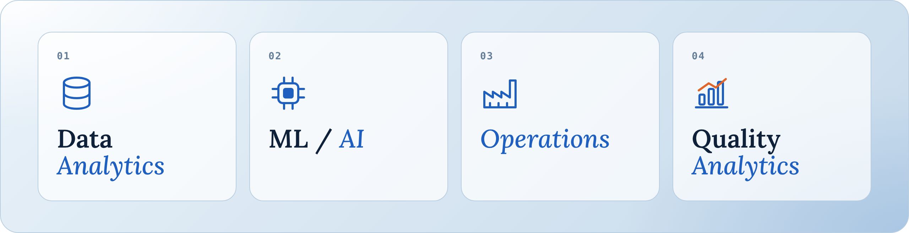</a>

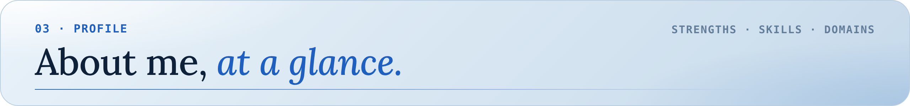

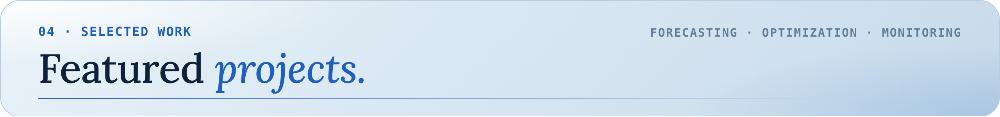

<a href="https://github.com/krishna6116/CareOps-AI">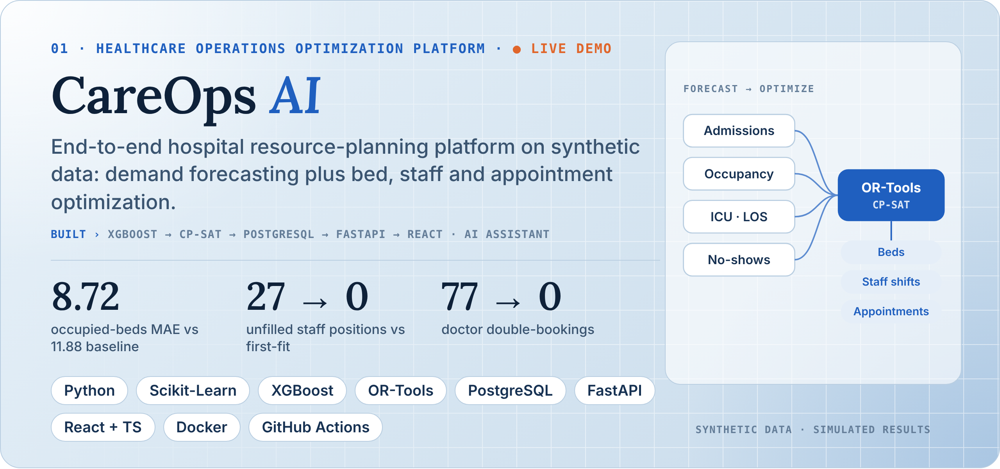</a>

<a href="https://github.com/krishna6116/Predictive-Maintenance-OEE">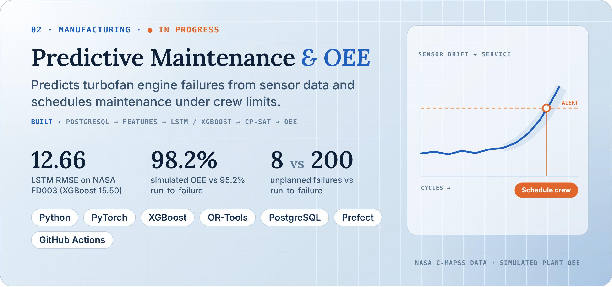</a>

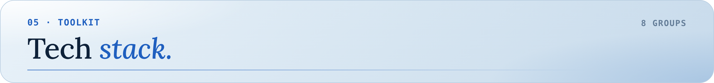

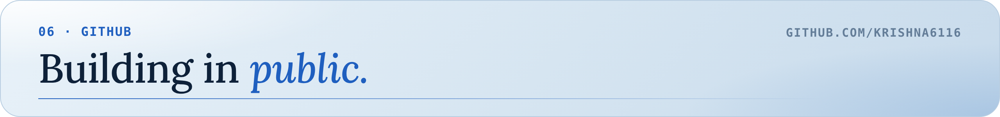

<!-- [ADD: contribution snake] Optional: add a GitHub Action that generates a contribution-graph animation, then embed it here. -->

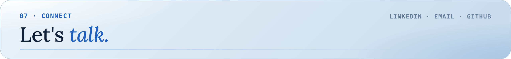

